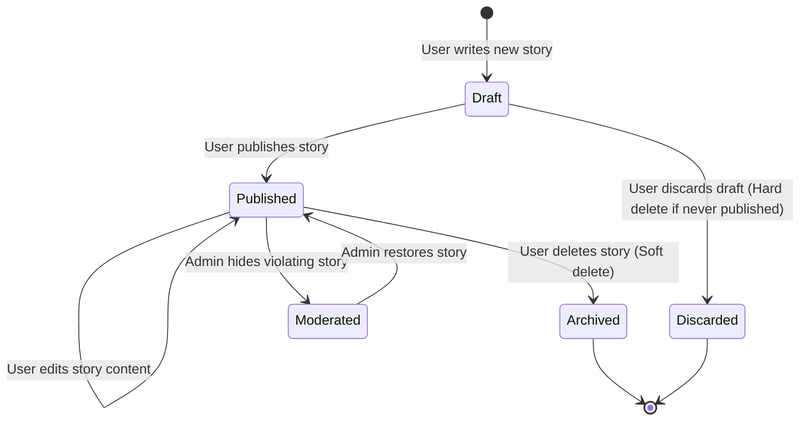
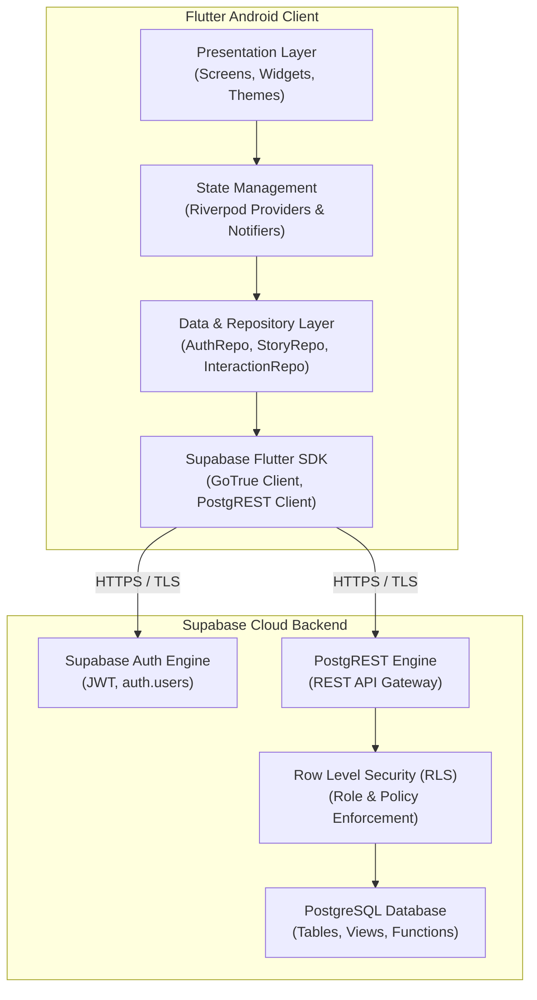
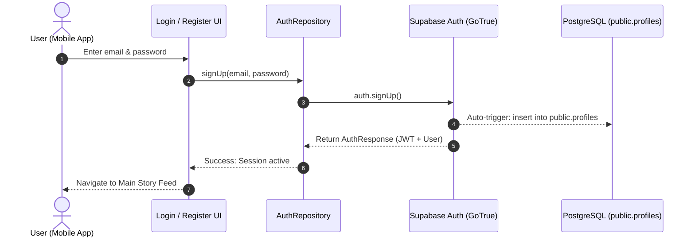
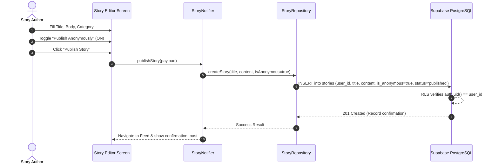
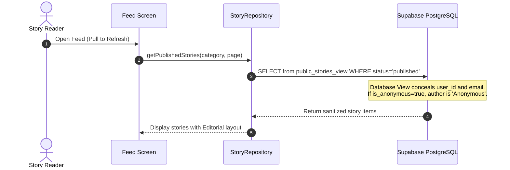
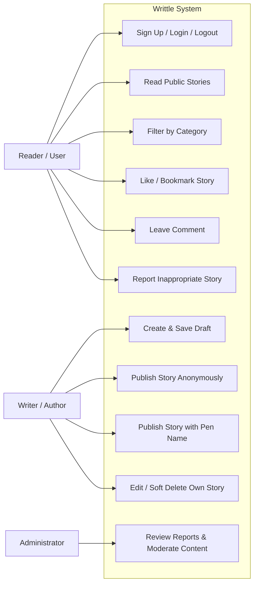
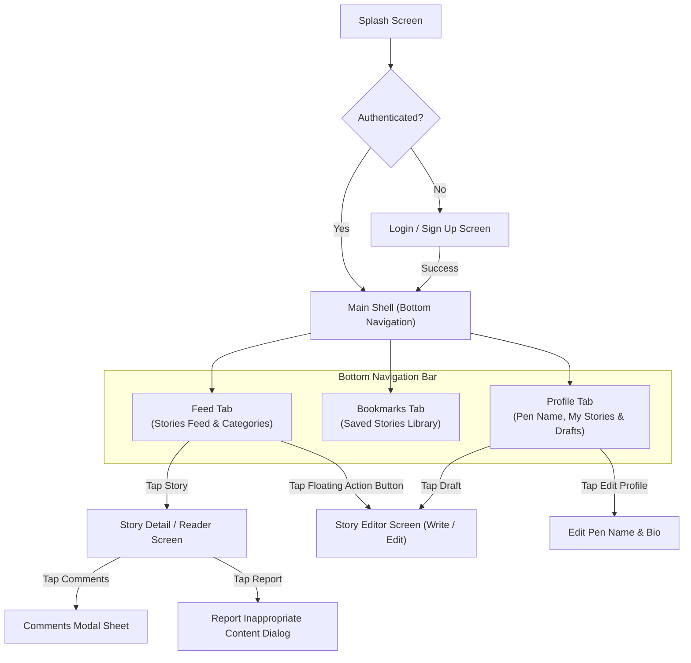

# Writtle — Business and System Design

**Document Version:** 1.0.0  
**Status:** Draft / Pending Review  
**Product:** Writtle (Anonymous Storytelling Application)  
**Target:** Flutter (Android) + Supabase  

---

# PART 1: BUSINESS LOGIC & RULES

This section outlines the core operational and domain rules governing the Writtle platform. All business rules are assigned a permanent identifier (`BR-xxx`).

---

## 1. Authentication & Identity Rules

### `BR-001`: Account Creation & Registration
- Users must provide an email and password to create an account.
- Passwords must be at least 8 characters in length.
- Upon registration, an internal user record is automatically created in `auth.users` (Supabase Auth) and an associated record is initialized in the `public.profiles` table.
- A random, unique default Pen Name (e.g. `Author_8192` or `Wanderer_401`) is generated for new accounts.

### `BR-002`: Separation of Identities
Writtle defines three distinct identity layers:
1. **Private Account Identity:** Email address and `auth.users.id`. Strictly internal, never displayed publicly under any circumstance.
2. **Pseudonymous Identity (Pen Name):** The public alias chosen by the user in their profile (e.g. `UrbanMonk`). Used when the author chooses to publish non-anonymously.
3. **Pure Anonymous Mode:** Stories published under this mode completely sever public linkage to both the real account and the Pen Name. The author string is rendered simply as `"Anonymous"`.

### `BR-003`: Public Anonymity Protection
- When a story is marked as `is_anonymous = true`, client-facing queries must not return the author's `user_id`, Pen Name, or avatar.
- Even if a user inspects the raw HTTP/JSON network response, no identifying metadata may be exposed.
- Internal database storage retains `user_id` strictly for author ownership validation (e.g., enabling the author to edit/delete their own story).

---

## 2. Story Lifecycle & Publishing Rules

### `BR-004`: Story States & Visibility
A story exists in one of the following states:
- `draft`: Only visible to the author. Not listed in public feeds or search results.
- `published`: Publicly visible to all readers in feeds and detail views, provided it is not archived or moderated.
- `archived`: Soft-deleted by the author. Hidden from public feeds and user profile, but preserved in the database for reference integrity and moderation audit.
- `moderated`: Hidden from all public feeds due to administrative action or policy violation.

### `BR-005`: Story Creation & Publishing Validation
- **Title:** Minimum 3 characters, maximum 120 characters. Cannot be blank.
- **Content:** Minimum 30 characters, maximum 15,000 characters.
- **Category:** Must belong to the approved list of categories (`Reflections`, `Romance`, `Life Lessons`, `Fiction`, `Confessions`).
- **Anonymity Selection:** Author must explicitly designate whether the story is published anonymously (`is_anonymous = true`) or with their Pen Name (`is_anonymous = false`).
- Precondition: User must be authenticated.
- Expected Outcome: Record inserted into `stories` with appropriate status and timestamps.

### `BR-006`: Story Ownership & Editing
- Only the user whose `auth.uid()` matches `stories.user_id` may modify or soft-delete a story.
- An author may switch a published story from Pen Name to Anonymous at any time, but switching from Anonymous to Pen Name is allowed only by the original author.
- Edits made to published stories update the `updated_at` timestamp.

### `BR-007`: Draft Management
- A user may have multiple drafts stored privately.
- Drafts can be saved with incomplete data (e.g. title without content, or content without title).
- Drafts are strictly confidential: no other user or reader can read, list, or search another user's drafts.

---

## 3. Social Interactions & Community Rules

### `BR-008`: Story Reactions (Likes)
- Any authenticated user can like a published story.
- Liking is idempotent: a user can like a story at most once. Liking again acts as an "unlike" (toggling state).
- The total like count is cached or computed and displayed on the story.
- Liking an anonymous story does not reveal the author's identity to the liker, nor does it reveal the liker's identity to the public.

### `BR-009`: Bookmarking
- Authenticated users can bookmark published stories for personal reference.
- Bookmarks are strictly private to the user who created them.
- Users can view all their bookmarked stories in a dedicated "Bookmarks" library screen.

### `BR-010`: Comments & Discussion
- Authenticated users may post comments on any published story.
- Comments require content between 2 and 1,000 characters.
- Comment authors can delete their own comments.
- Story authors can delete any comment on their own story to preserve a constructive and respectful atmosphere.

---

## 4. Moderation & Abuse Prevention

### `BR-011`: User Reports
- Authenticated users can report a story for: `spam`, `harassment`, `hate_speech`, `explicit_content`, or `other`.
- A user may only submit one active report per story to prevent duplicate spam reporting.
- Reports are stored in a dedicated `reports` table accessible only to authenticated reporters (to insert) and administrators (to read and resolve).

### `BR-012`: Administrative Moderation
- Content flagged with multiple reports or deemed harmful can be marked with `status = 'moderated'` by an administrator.
- Once moderated, the story is instantly removed from public feeds and detail screens.
- For MVP, moderation actions are performed directly by the administrator via the Supabase dashboard.

---

## 5. Summary of Preconditions & Postconditions

| Operation | Precondition | Business Rule IDs | Expected Outcome |
| :--- | :--- | :--- | :--- |
| **Save Draft** | Authenticated user | `BR-001`, `BR-007` | Draft created/updated in `stories` with `status='draft'`. |
| **Publish Story** | Authenticated user, valid fields | `BR-005`, `BR-006` | Story updated with `status='published'`, `published_at=NOW()`. |
| **Edit Story** | Authenticated author | `BR-006` | Story content updated, `updated_at=NOW()`. |
| **Delete Story** | Authenticated author | `BR-004`, `BR-006` | Story soft-deleted (`deleted_at=NOW()`, `status='archived'`). |
| **Like Story** | Authenticated user | `BR-008` | Like row added/removed; counter updated. |
| **Add Comment** | Authenticated user, valid text | `BR-010` | Comment row added to `comments` table. |
| **Report Story** | Authenticated user, story exists | `BR-011` | Report row created in `reports`. |

---

# PART 2: SYSTEM DESIGN & ARCHITECTURE

---

## 6. System Overview & Architecture

Writtle utilizes a clean **2-Tier Client-Cloud Architecture**:
- **Mobile Client (Frontend):** Flutter application running on Android, implementing a layered clean architecture pattern (UI View $\leftrightarrow$ Riverpod State Providers $\leftrightarrow$ Repositories $\leftrightarrow$ Supabase Client SDK).
- **Backend as a Service (BaaS):** Supabase providing managed PostgreSQL, Auth Engine, REST/PostgREST APIs, and Row Level Security (RLS) enforcement.

---

## 7. Application Modules & Responsibilities

| Module | Location in Code | Responsibility |
| :--- | :--- | :--- |
| **Core** | `lib/core/` | Global constants, theme tokens, error types, network failure mappers, and utility helpers. |
| **Auth** | `lib/features/auth/` | Login, sign up, session management, and auth state listener. |
| **Profile** | `lib/features/profile/` | Viewing personal profile, editing Pen Name and bio, listing user's own stories and drafts. |
| **Feed / Stories** | `lib/features/stories/` | Story feed, category filtering, reading view, story creation and draft editing. |
| **Interactions** | `lib/features/interactions/` | Likes, bookmarks library, and comment discussions. |
| **Moderation** | `lib/features/moderation/` | User reporting dialog and submission handling. |

---

## 8. Critical System Workflows

### 8.1. Authentication Flow

### 8.2. Story Publishing Flow (Anonymity Enforced)

### 8.3. Public Story Reading Flow (Privacy Preserved)

---

## 9. Use Case Diagram

---

## 10. Navigation Flow

The mobile application utilizes a 3-tab Bottom Navigation Bar paired with modal or full-screen routes for focused tasks:

---

## 11. Architectural Decisions & Rationale

| Decision | Selected Choice | Rejected Alternative | Rationale |
| :--- | :--- | :--- | :--- |
| **State Management** | **Flutter Riverpod** | BLoC, Vanilla Provider | Riverpod offers compile-safe dependency injection, zero `BuildContext` leakage in business logic, and test-friendly provider overriding. |
| **Database & Auth** | **Supabase** | Firebase, Custom NodeJS | PostgreSQL provides robust relational integrity for comments, likes, and reports. Row Level Security guarantees data isolation directly at database level. |
| **Anonymity Architecture** | **PostgreSQL Public View / Secure Projection** | Client-side data masking | Masking on client is dangerous as raw JSON can be sniffed via proxies; masking at DB level guarantees zero exposure. |
| **Story Format** | **Structured Plain Text** | Rich HTML / Heavy Markdown | Preserves the calm, book-like editorial aesthetic and avoids layout fragmentation or script injection vulnerabilities. |
