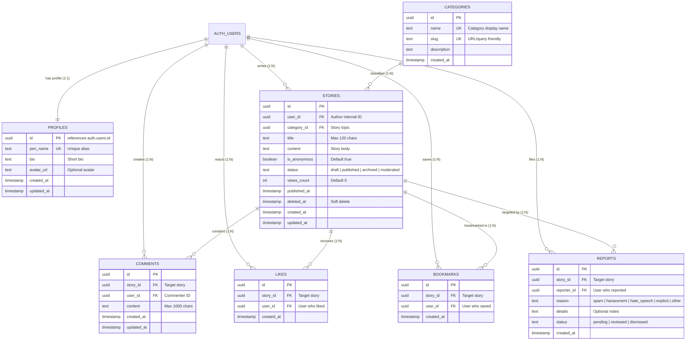

# Writtle — Database and API Specification

**Document Version:** 1.0.0  
**Status:** Draft / Pending Review  
**Product:** Writtle (Anonymous Storytelling Application)  
**Database Engine:** PostgreSQL 15+ (via Supabase)  

---

# PART 1: DATABASE DESIGN & SCHEMA

---

## 1. Entity Relationship Diagram (ERD)



---

## 2. Table Definitions & Constraints

### 2.1. Table: `profiles`
Stores public pseudonymous identities. Never stores passwords or billing details.

| Column | Type | Constraints | Description |
| :--- | :--- | :--- | :--- |
| `id` | `UUID` | `PRIMARY KEY REFERENCES auth.users(id) ON DELETE CASCADE` | Matches Supabase Auth user ID. |
| `pen_name` | `VARCHAR(32)` | `NOT NULL UNIQUE` | Public pen name / alias (e.g. `NightOwl_42`). |
| `bio` | `VARCHAR(200)` | `NULL` | Short personal statement or description. |
| `avatar_url` | `TEXT` | `NULL` | Public avatar image or preset asset key. |
| `created_at` | `TIMESTAMPTZ` | `NOT NULL DEFAULT NOW()` | Record creation timestamp. |
| `updated_at` | `TIMESTAMPTZ` | `NOT NULL DEFAULT NOW()` | Last update timestamp. |

### 2.2. Table: `categories`
Reference table for categorizing narratives.

| Column | Type | Constraints | Description |
| :--- | :--- | :--- | :--- |
| `id` | `UUID` | `PRIMARY KEY DEFAULT gen_random_uuid()` | Unique category identifier. |
| `name` | `VARCHAR(50)` | `NOT NULL UNIQUE` | Name (e.g., `Reflections`, `Life Lessons`). |
| `slug` | `VARCHAR(50)` | `NOT NULL UNIQUE` | Slug (e.g., `reflections`, `life-lessons`). |
| `description`| `VARCHAR(255)`| `NULL` | Short description of the topic. |
| `created_at` | `TIMESTAMPTZ` | `NOT NULL DEFAULT NOW()` | Timestamp. |

*Pre-seeded values:*
1. `Reflections` (`reflections`) — Introspective thoughts and personal growth.
2. `Romance` (`romance`) — Love, heartbreak, and emotional encounters.
3. `Life Lessons` (`life-lessons`) — Experiences that shaped perspectives.
4. `Fiction` (`fiction`) — Creative storytelling and imaginative prose.
5. `Confessions` (`confessions`) — Secrets and untold burdens shared safely.

### 2.3. Table: `stories`
Core content entity containing narrative drafts and published pieces.

| Column | Type | Constraints | Description |
| :--- | :--- | :--- | :--- |
| `id` | `UUID` | `PRIMARY KEY DEFAULT gen_random_uuid()` | Unique story ID. |
| `user_id` | `UUID` | `NOT NULL REFERENCES auth.users(id) ON DELETE CASCADE` | Internal author reference. |
| `category_id`| `UUID` | `NOT NULL REFERENCES categories(id)` | Associated topic. |
| `title` | `VARCHAR(120)`| `NOT NULL` | Story title. |
| `content` | `TEXT` | `NOT NULL` | Full story narrative body. |
| `is_anonymous`| `BOOLEAN` | `NOT NULL DEFAULT TRUE` | If true, conceal author identity in public. |
| `status` | `VARCHAR(20)` | `NOT NULL DEFAULT 'draft'` | `draft`, `published`, `archived`, `moderated`. |
| `views_count`| `INTEGER` | `NOT NULL DEFAULT 0` | Simple reader view tally. |
| `published_at`| `TIMESTAMPTZ`| `NULL` | Timestamp when first published. |
| `deleted_at` | `TIMESTAMPTZ` | `NULL` | Non-null indicates soft-deleted status. |
| `created_at` | `TIMESTAMPTZ` | `NOT NULL DEFAULT NOW()` | Creation timestamp. |
| `updated_at` | `TIMESTAMPTZ` | `NOT NULL DEFAULT NOW()` | Modification timestamp. |

### 2.4. Table: `comments`

| Column | Type | Constraints | Description |
| :--- | :--- | :--- | :--- |
| `id` | `UUID` | `PRIMARY KEY DEFAULT gen_random_uuid()` | Comment ID. |
| `story_id` | `UUID` | `NOT NULL REFERENCES stories(id) ON DELETE CASCADE` | Story being commented on. |
| `user_id` | `UUID` | `NOT NULL REFERENCES auth.users(id) ON DELETE CASCADE` | Author of the comment. |
| `content` | `VARCHAR(1000)`| `NOT NULL` | Comment text. |
| `created_at` | `TIMESTAMPTZ` | `NOT NULL DEFAULT NOW()` | Comment submission time. |
| `updated_at` | `TIMESTAMPTZ` | `NOT NULL DEFAULT NOW()` | Last edit time. |

### 2.5. Table: `likes`

| Column | Type | Constraints | Description |
| :--- | :--- | :--- | :--- |
| `id` | `UUID` | `PRIMARY KEY DEFAULT gen_random_uuid()` | Reaction ID. |
| `story_id` | `UUID` | `NOT NULL REFERENCES stories(id) ON DELETE CASCADE` | Target story. |
| `user_id` | `UUID` | `NOT NULL REFERENCES auth.users(id) ON DELETE CASCADE` | Interacting user. |
| `created_at` | `TIMESTAMPTZ` | `NOT NULL DEFAULT NOW()` | Timestamp. |

*Unique Index:* `UNIQUE (story_id, user_id)` (prevents duplicate likes).

### 2.6. Table: `bookmarks`

| Column | Type | Constraints | Description |
| :--- | :--- | :--- | :--- |
| `id` | `UUID` | `PRIMARY KEY DEFAULT gen_random_uuid()` | Bookmark ID. |
| `story_id` | `UUID` | `NOT NULL REFERENCES stories(id) ON DELETE CASCADE` | Target story. |
| `user_id` | `UUID` | `NOT NULL REFERENCES auth.users(id) ON DELETE CASCADE` | User saving the story. |
| `created_at` | `TIMESTAMPTZ` | `NOT NULL DEFAULT NOW()` | Timestamp. |

*Unique Index:* `UNIQUE (story_id, user_id)` (prevents duplicate bookmarks).

### 2.7. Table: `reports`

| Column | Type | Constraints | Description |
| :--- | :--- | :--- | :--- |
| `id` | `UUID` | `PRIMARY KEY DEFAULT gen_random_uuid()` | Report ticket ID. |
| `story_id` | `UUID` | `NOT NULL REFERENCES stories(id) ON DELETE CASCADE` | Reported story. |
| `reporter_id`| `UUID` | `NOT NULL REFERENCES auth.users(id) ON DELETE CASCADE` | Submitting user. |
| `reason` | `VARCHAR(50)` | `NOT NULL` | Violation reason code. |
| `details` | `VARCHAR(500)`| `NULL` | Additional explanatory notes. |
| `status` | `VARCHAR(20)` | `NOT NULL DEFAULT 'pending'` | `pending`, `reviewed`, `dismissed`. |
| `created_at` | `TIMESTAMPTZ` | `NOT NULL DEFAULT NOW()` | Timestamp. |

*Unique Index:* `UNIQUE (story_id, reporter_id)` (prevents abuse reporting floods).

---

## 3. Privacy Preservation: `public_stories_view`

To enforce strict anonymity at the database level and prevent leaks of `user_id` over the wire, public feed reads query a sanitized PostgreSQL VIEW:

```sql
CREATE OR REPLACE VIEW public_stories_view AS
SELECT 
    s.id,
    s.category_id,
    c.name AS category_name,
    c.slug AS category_slug,
    s.title,
    s.content,
    s.is_anonymous,
    CASE 
        WHEN s.is_anonymous THEN 'Anonymous' 
        ELSE p.pen_name 
    END AS author_name,
    CASE 
        WHEN s.is_anonymous THEN NULL 
        ELSE p.avatar_url 
    END AS author_avatar_url,
    s.published_at,
    s.created_at,
    s.views_count,
    COALESCE(like_counts.count, 0) AS likes_count,
    COALESCE(comment_counts.count, 0) AS comments_count
FROM stories s
JOIN categories c ON s.category_id = c.id
LEFT JOIN profiles p ON s.user_id = p.id
LEFT JOIN (
    SELECT story_id, COUNT(*) AS count FROM likes GROUP BY story_id
) like_counts ON s.id = like_counts.story_id
LEFT JOIN (
    SELECT story_id, COUNT(*) AS count FROM comments GROUP BY story_id
) comment_counts ON s.id = comment_counts.story_id
WHERE s.status = 'published' AND s.deleted_at IS NULL;
```

---

## 4. Row Level Security (RLS) Policies

All tables have RLS explicitly enabled: `ALTER TABLE <table_name> ENABLE ROW LEVEL SECURITY;`

### 4.1. `profiles` Policies
- **Public Read:** `CREATE POLICY "Public profiles are viewable by everyone" ON profiles FOR SELECT USING (true);`
- **Owner Update:** `CREATE POLICY "Users can update own profile" ON profiles FOR UPDATE USING (auth.uid() = id);`

### 4.2. `stories` Policies
- **Read:**
  - Published & Non-deleted: Viewable by anyone (`status = 'published' AND deleted_at IS NULL`).
  - Drafts & Archived: Viewable ONLY by author (`auth.uid() = user_id`).
- **Insert:**
  - Authenticated users can insert only where `user_id = auth.uid()`.
- **Update:**
  - Only author can update (`auth.uid() = user_id`).
- **Delete:**
  - Direct `DELETE` disabled; soft delete handled via update `deleted_at = NOW()`.

### 4.3. `comments` Policies
- **Read:** Comments on published, active stories are viewable by anyone.
- **Insert:** Authenticated users can insert their own comment (`user_id = auth.uid()`).
- **Delete:** Comment author (`user_id = auth.uid()`) OR story author (`EXISTS (SELECT 1 FROM stories WHERE stories.id = comments.story_id AND stories.user_id = auth.uid())`).

### 4.4. `likes` & `bookmarks` Policies
- **Read:** Authenticated users can view their own likes and bookmarks (`user_id = auth.uid()`).
- **Insert:** Authenticated users can like/bookmark (`user_id = auth.uid()`).
- **Delete:** Authenticated users can remove their own like/bookmark (`user_id = auth.uid()`).

### 4.5. `reports` Policies
- **Insert:** Authenticated users can submit a report (`reporter_id = auth.uid()`).
- **Read/Update:** Restricted to administrators (`auth.jwt() ->> 'role' = 'service_role'` or designated admin table).

---

# PART 2: API SPECIFICATION (SUPABASE CLIENT)

Since Writtle uses the official `supabase_flutter` SDK, operations are invoked using typed PostgREST queries over HTTPS.

---

## 5. Authentication APIs

### 5.1. Sign Up with Email
- **Method:** `supabase.auth.signUp(email: email, password: password)`
- **Request Body:** `{ email: string, password: string }`
- **Response (200 OK):**
  ```json
  {
    "user": {
      "id": "c8b417c8-09dc-4f01-817e-7c5efc07b789",
      "email": "student@example.com",
      "created_at": "2026-10-23T06:00:00Z"
    },
    "session": { "access_token": "jwt_token...", "refresh_token": "..." }
  }
  ```

### 5.2. Sign In with Email
- **Method:** `supabase.auth.signInWithPassword(email: email, password: password)`
- **Response (200 OK):** Returns active session with JWT token.

### 5.3. Sign Out
- **Method:** `supabase.auth.signOut()`

---

## 6. Story APIs

### 6.1. Get Published Feed (Public)
- **Method:**
  ```dart
  supabase
    .from('public_stories_view')
    .select()
    .order('published_at', ascending: false)
    .range(from, to);
  ```
- **Filter by Category:** `.eq('category_slug', slug)`
- **Sample Response (200 OK):**
  ```json
  [
    {
      "id": "90e0b3c8-6625-4521-b1e0-b6e92716a041",
      "category_id": "e8387063-f09b-44a5-9f5b-df972da5ea9b",
      "category_name": "Reflections",
      "category_slug": "reflections",
      "title": "Finding Silence in a Loud City",
      "content": "Every evening around 7 PM, the traffic outside my window...",
      "is_anonymous": true,
      "author_name": "Anonymous",
      "author_avatar_url": null,
      "published_at": "2026-10-23T05:30:00Z",
      "views_count": 42,
      "likes_count": 8,
      "comments_count": 3
    }
  ]
  ```

### 6.2. Create / Publish Story
- **Method:**
  ```dart
  supabase.from('stories').insert({
    'category_id': categoryId,
    'title': title,
    'content': content,
    'is_anonymous': isAnonymous,
    'status': isDraft ? 'draft' : 'published',
    'published_at': isDraft ? null : DateTime.now().toIso8601String(),
  }).select().single();
  ```

### 6.3. Get My Stories & Drafts
- **Method:**
  ```dart
  supabase
    .from('stories')
    .select('*, categories(name)')
    .eq('user_id', supabase.auth.currentUser!.id)
    .isFilter('deleted_at', null)
    .order('updated_at', ascending: false);
  ```

### 6.4. Soft Delete Story
- **Method:**
  ```dart
  supabase
    .from('stories')
    .update({
      'status': 'archived',
      'deleted_at': DateTime.now().toIso8601String(),
    })
    .eq('id', storyId);
  ```

---

## 7. Interaction & Moderation APIs

### 7.1. Toggle Like
- **Check Liked:** `supabase.from('likes').select('id').eq('story_id', storyId).eq('user_id', uid).maybeSingle()`
- **Insert Like:** `supabase.from('likes').insert({ 'story_id': storyId, 'user_id': uid })`
- **Delete Like:** `supabase.from('likes').delete().eq('story_id', storyId).eq('user_id', uid)`

### 7.2. Toggle Bookmark
- **Check Bookmarked:** `supabase.from('bookmarks').select('id').eq('story_id', storyId).eq('user_id', uid).maybeSingle()`
- **Insert Bookmark:** `supabase.from('bookmarks').insert({ 'story_id': storyId, 'user_id': uid })`
- **Delete Bookmark:** `supabase.from('bookmarks').delete().eq('story_id', storyId).eq('user_id', uid)`

### 7.3. Submit User Report
- **Method:**
  ```dart
  supabase.from('reports').insert({
    'story_id': storyId,
    'reporter_id': uid,
    'reason': reasonCode,
    'details': optionalText,
  });
  ```

---

## 8. Dart Model Mapping

Application models in Flutter (`lib/models/`) will map directly to these data contracts:
- `UserModel` $\leftrightarrow$ `profiles` + `auth.users`
- `StoryModel` $\leftrightarrow$ `public_stories_view` (feed) / `stories` (author management)
- `CategoryModel` $\leftrightarrow$ `categories`
- `CommentModel` $\leftrightarrow$ `comments` + `profiles`
- `ReportModel` $\leftrightarrow$ `reports`
